<div dir="rtl">

# نجوا

گفتگوی خصوصی دونفره، با رمزنگاری سرتاسری. پیام، عکس، ویدیو، فایل، ویس و تماس صوتی، همه روی دستگاه خود شما رمز می‌شوند. سرور فقط نسخه‌ی رمزشده را جابه‌جا می‌کند و نگه می‌دارد و هیچ کلیدی ندارد. نجوا حساب کاربری، شماره تلفن و ایمیل نمی‌خواهد: یک کد اتاق و یک رمز کافی است.

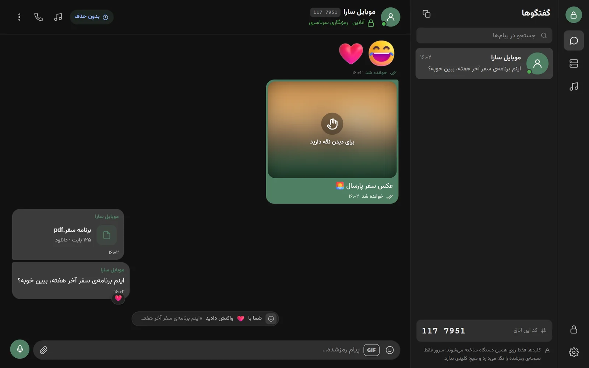

## امکانات

### ساخت اتاق، بدون حساب کاربری

یک نفر اتاق می‌سازد: یک کد هفت‌رقمی و یک رمز. کد و رمز را جداگانه به طرف مقابل می‌دهد (مثلاً کد را با پیامک و رمز را حضوری). کلیدها از روی همین رمز و فقط روی دستگاه‌ها ساخته می‌شوند. هر اتاق حداکثر سه دستگاه هم‌زمان دارد.

| صفحه‌ی اول | ساخت اتاق | اتاق تازه، منتظر طرف مقابل |
|---|---|---|
| 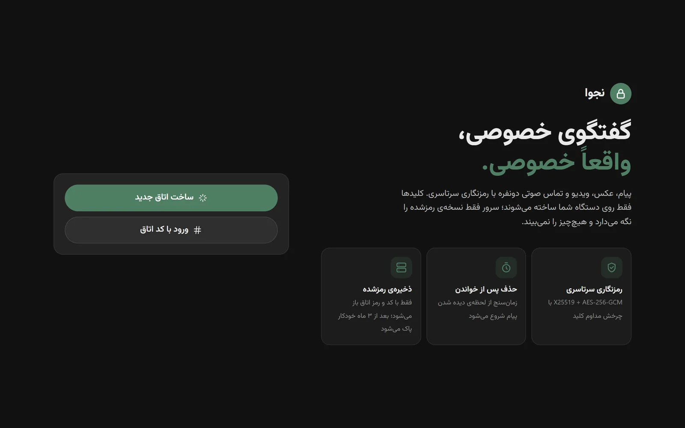 | 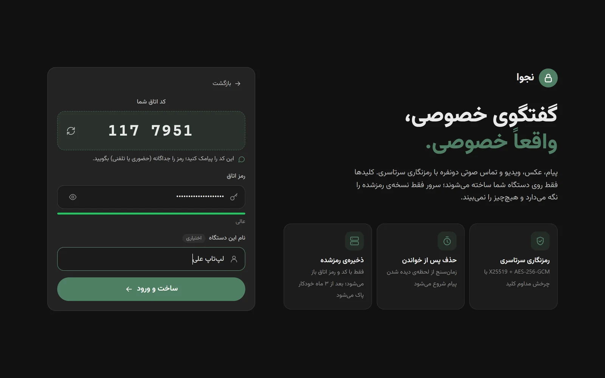 | 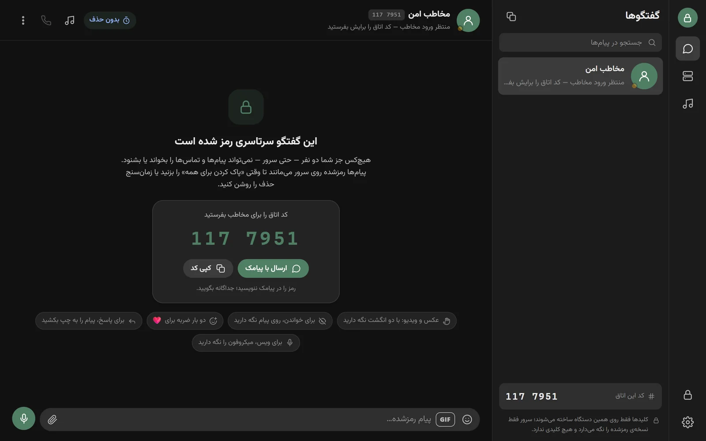 |

- **رمزنگاری:** X25519 برای توافق کلید و AES-256-GCM برای پیام‌ها. کلیدها مدام چرخانده می‌شوند، پس لو رفتن یک کلید پیام‌های دیگر را باز نمی‌کند.
- **تاریخچه‌ی رمزشده:** پیام‌ها رمزشده روی سرور می‌مانند تا با دستگاه دیگر یا بعداً هم دیده شوند. پیش‌فرض سه ماه نگه داشته می‌شوند و بعد خودکار پاک می‌شوند.

### متن محرمانه (ضد زوم)

متن پیام‌ها، عکس‌ها و گیف‌ها پشت یک اسپویلر ذره‌ای (مثل تلگرام) پنهان است. فقط وقتی انگشت روی پیام نگه داشته شود، یا ماوس روی آن باشد، یا دکمه‌ی چشم زده شود (۱۰ ثانیه)، دیده می‌شود. این‌طوری کسی از کنار شما یا با زوم یک گوشی دیگر نمی‌تواند پیام‌ها را بخواند. از تنظیمات خاموش می‌شود.

| متن محرمانه در کامپیوتر | در موبایل |
|---|---|
| 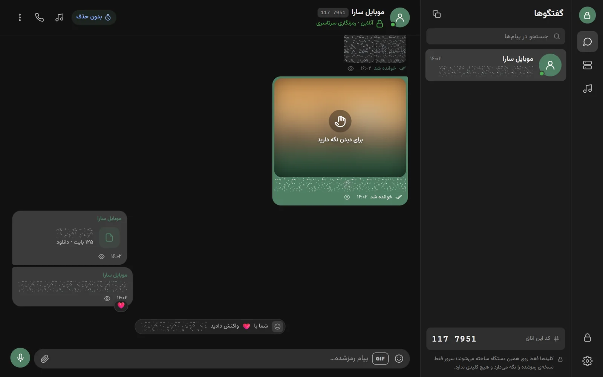 | 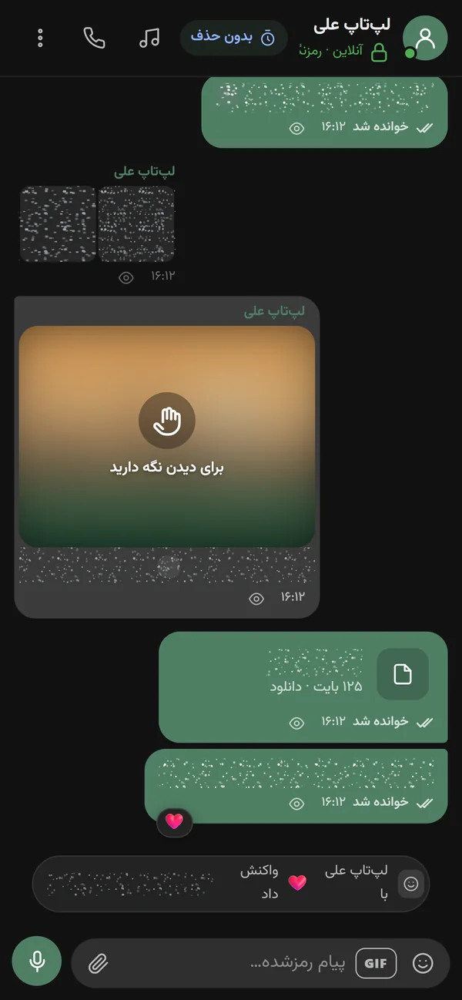 |

### پیام خودحذف

برای هر گفتگو می‌شود تعیین کرد پیام‌ها چند وقت **بعد از خوانده شدن** پاک شوند: ۱۰ ثانیه، ۳۰ ثانیه، ۱ دقیقه، ۵ دقیقه، ۳۰ دقیقه یا ۱ ساعت. پیام از همه‌ی دستگاه‌ها و از سرور پاک می‌شود.

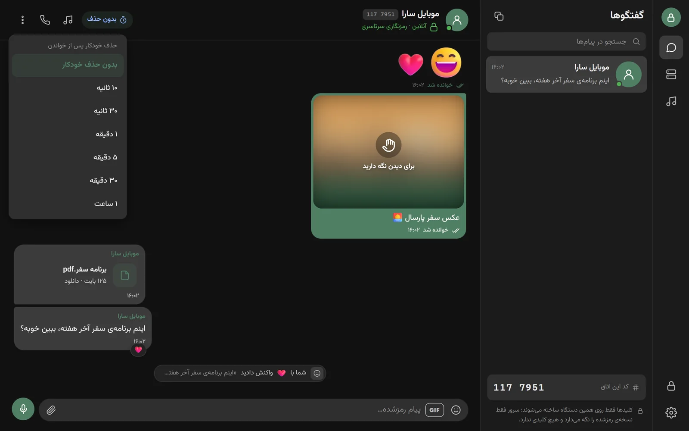

### ایموجی متحرک، گیف و واکنش

- **ایموجی‌ها:** مجموعه‌ی متحرک Fluent، روی سرور خود نجوا. هیچ سرویس دیگری نمی‌فهمد چه ایموجی‌ای استفاده می‌کنید. جستجو فارسی و انگلیسی است و رنگ پوست هم دارد.
- **گیف:** جستجو در GIPHY و Tenor از طریق سرور نجوا، پس دستگاه شما به آن‌ها وصل نمی‌شود.
- **واکنش:** با دوبار زدن روی پیام قلب می‌گذارید. با نگه داشتن یا کلیک راست، واکنش‌های دیگر هم هست.

| ایموجی | گیف | واکنش |
|---|---|---|
| 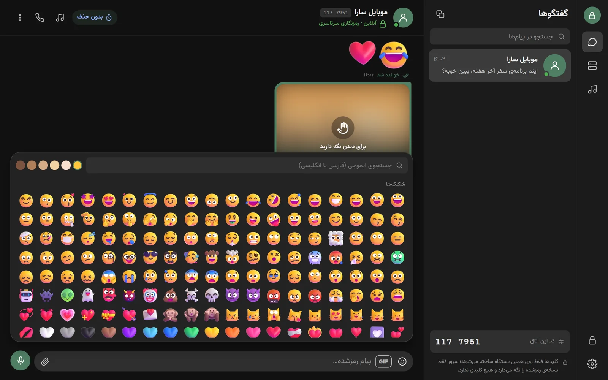 | 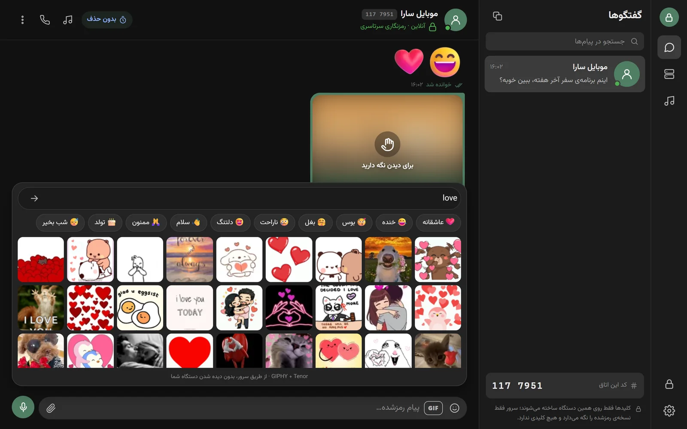 | 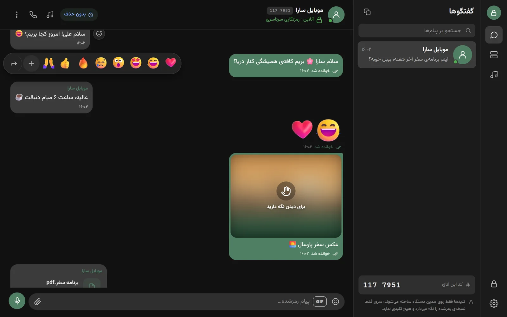 |

### عکس، ویدیو و فایل

- **ارسال:** عکس و ویدیو با توضیح فرستاده می‌شوند. هر فایلی تا ۱۰۰ مگابایت می‌رود. همه پیش از ارسال روی دستگاه رمز می‌شوند.
- **دیدن عکس و ویدیو:** فقط تا وقتی دکمه‌ی ماوس یا دو انگشت روی آن نگه داشته شده دیده می‌شود. عکس حداکثر ۱۰ ثانیه باز می‌ماند و ویدیو یک بار تا آخر پخش می‌شود. اگر وسط دیدن از صفحه بیرون بروید، به طرف مقابل خبر داده می‌شود.
- **ماندگار کردن:** هر عکس، ویدیو یا آهنگی را می‌شود روی همین دستگاه «ماندگار» کرد تا با حذف خودکار پاک نشود. طرف مقابل از این کار خبردار می‌شود.

| توضیح عکس | نمایشگر (نگه دارید) |
|---|---|
| 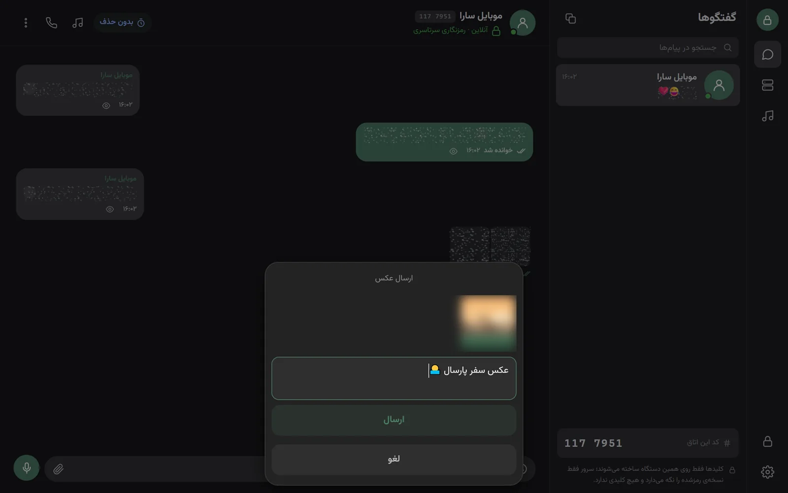 |  |

### موسیقی و ماندگارها

آهنگ بفرستید یا لینک یک فایل صوتی را بفرستید تا به‌صورت آهنگ برسد. یک پخش‌کننده‌ی کامل (پخش پشت سر هم، تصادفی، تکرار) و کتابخانه‌ی «ماندگارها» برای موسیقی، عکس و ویدیوهای ماندگار روی همین دستگاه هست.

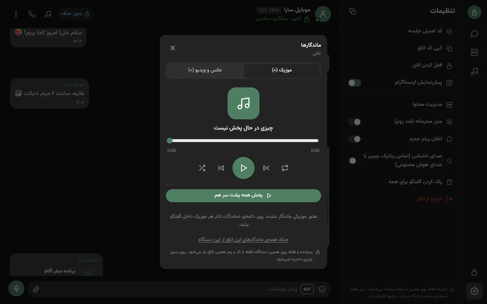

### تماس صوتی

تماس دو لایه رمز دارد: رمزنگاری خود WebRTC (DTLS-SRTP)، و یک لایه‌ی AES-256-GCM دیگر روی هر بسته‌ی صدا با کلیدهایی که فقط دو مرورگر دارند. تماس از طریق TURN کلادفلر می‌رود، پس IP هیچ‌کدام از دو طرف به دیگری نشان داده نمی‌شود.

| در حال زنگ | متصل |
|---|---|
| 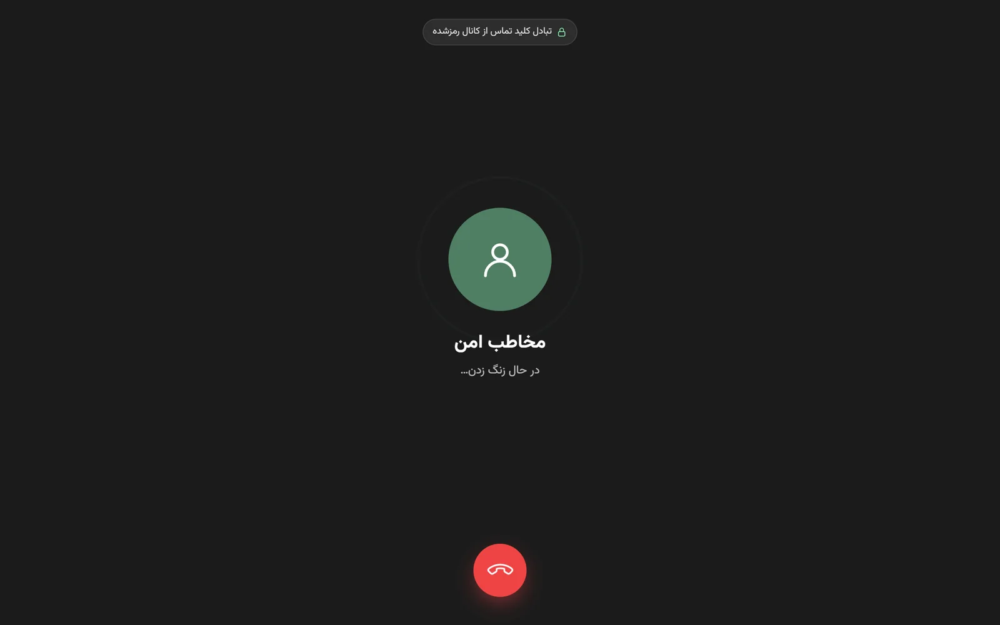 | 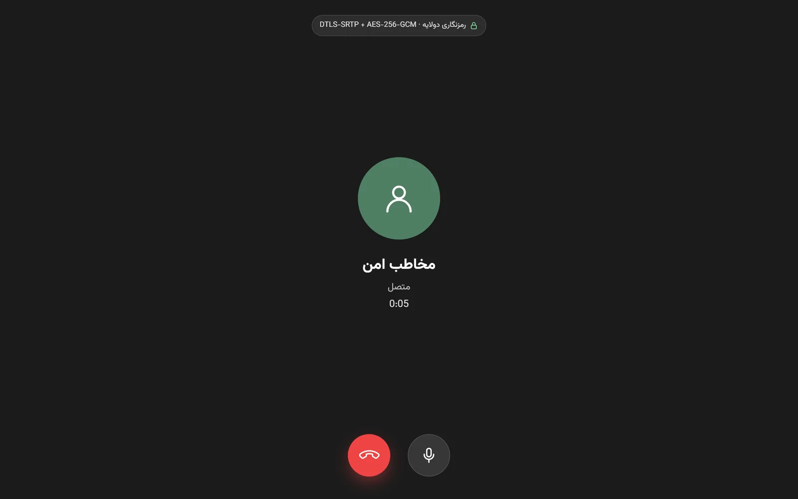 |

### صدای ناشناس

با روشن کردن «صدای ناشناس»، صدای شما در تماس رباتیک و بدون جنسیت می‌شود. ویس‌ها هم به متن تبدیل و با صدای هوش مصنوعی خوانده می‌شوند، پس صدای واقعی شما فرستاده نمی‌شود. همه‌ی این پردازش روی خود دستگاه انجام می‌شود.

### مدیریت محتوا

همه‌ی چیزهایی که از این گفتگو روی سرور هست، با حجمشان: جستجو در متن، فرستنده، نوع و تاریخ، و پاک کردن انتخابی برای همه.

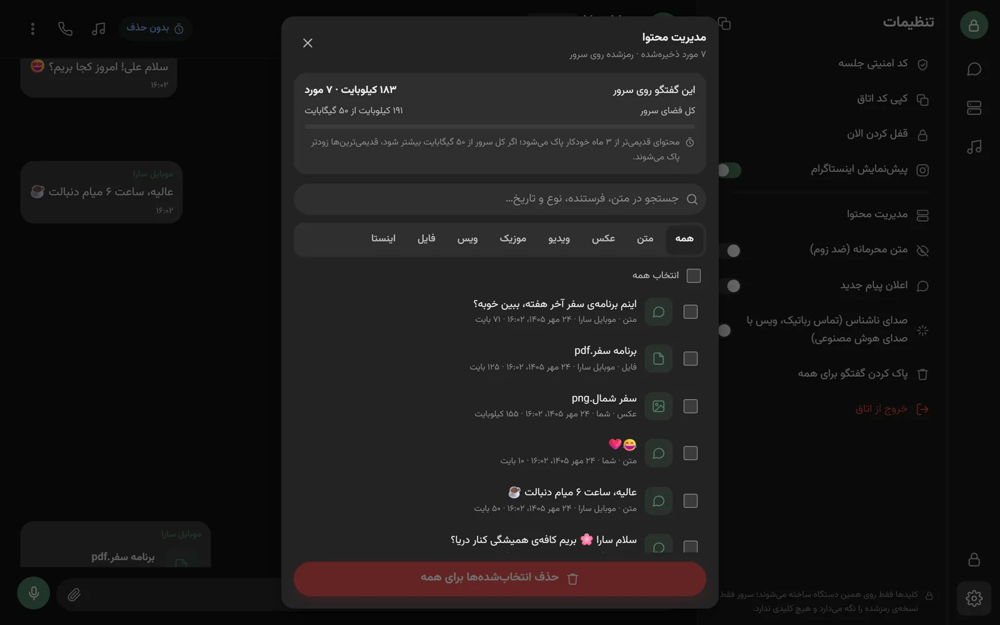

### قفل و محافظت

- **قفل خودکار:** با بیرون رفتن از صفحه (عوض کردن برنامه، خاموش شدن صفحه) اتاق قفل می‌شود و برای ادامه رمز لازم است. ۵ بار رمز اشتباه، همه‌چیز را از دستگاه پاک می‌کند.
- **قفل دستی:** از نوار کناری، یا با دوبار زدن روی جای خالی چت.
- **سپر:** وقتی پنجره از فوکوس خارج شود، صفحه پوشانده می‌شود. اگر کلید اسکرین‌شات کامپیوتر زده شود، صفحه پوشانده می‌شود و به طرف مقابل هم خبر داده می‌شود.

| قفل | تنظیمات |
|---|---|
| 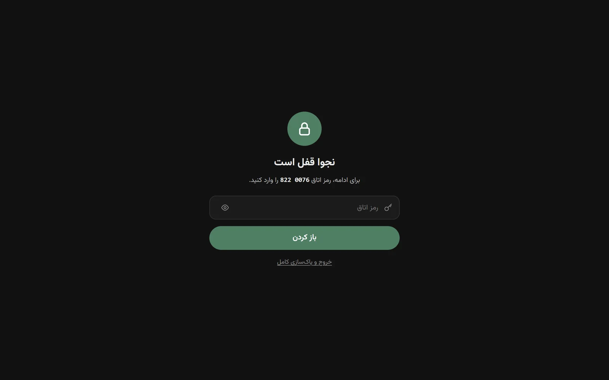 | 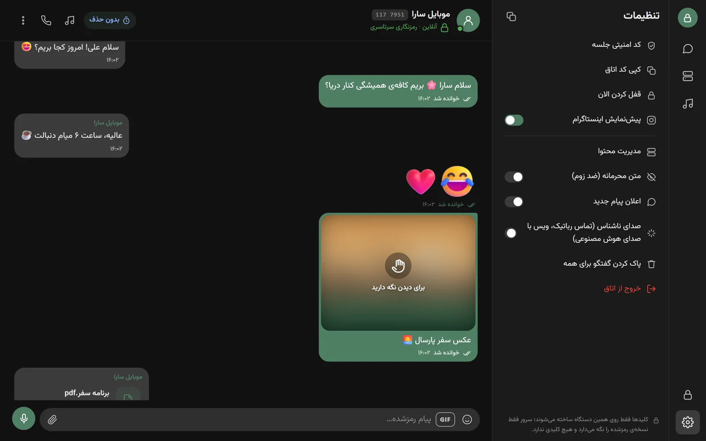 |

### و همچنین

- **پیام‌ها:** ویرایش پیام، جواب دادن با کشیدن پیام، و جستجو در پیام‌ها.
- **اینستاگرام:** لینک اینستاگرام پیش‌نمایش می‌گیرد.
- **کد امنیتی جلسه:** برای اطمینان از اینکه کسی وسط راه نیست، کد امنیتی جلسه را با طرف مقابل مقایسه کنید.
- **اعلان:** اعلان پیام جدید اختیاری است و هیچ متن یا اسمی نشان نمی‌دهد.
- **به‌روزرسانی خودکار:** با هر نسخه‌ی جدید، اپ‌های باز خودشان به‌روز می‌شوند.
- **حالت روشن:** حالت روشن و تیره، مطابق تنظیم دستگاه.

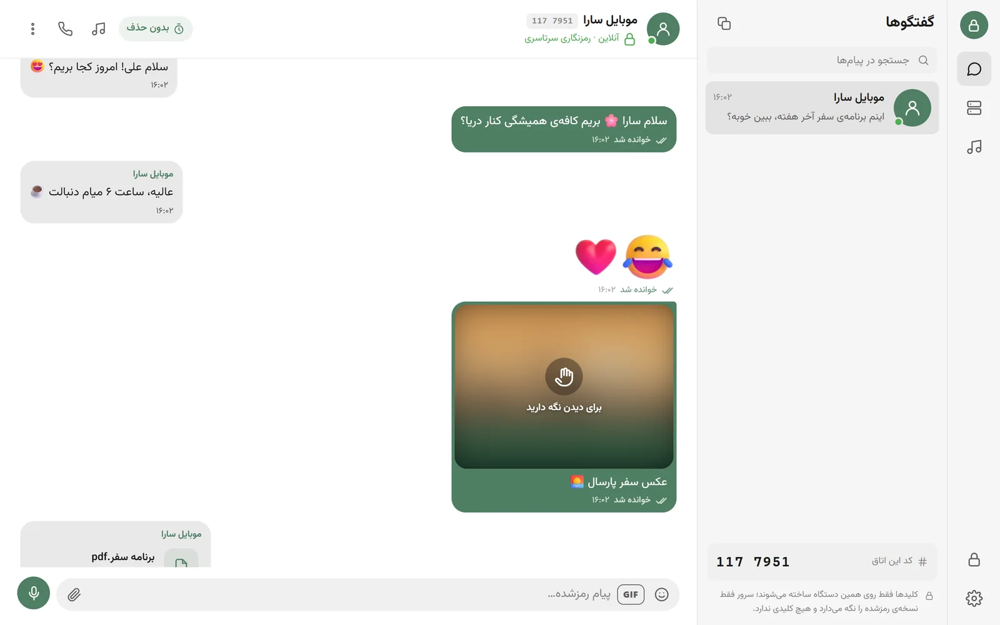

<details>
<summary>امکانات مخفی</summary>

**پیام زمان‌دار.** بالای چت، پنج بار سریع (در کمتر از ۳ ثانیه) روی اسم مخاطب بزنید. متن، تاریخ و ساعت (شمسی) را انتخاب کنید. پیام همان لحظه رمز می‌شود و روی سرور منتظر می‌ماند، پس حتی اگر دستگاه شما خاموش باشد سر وقت فرستاده می‌شود. پیام‌های در صف را همان‌جا می‌بینید و می‌توانید لغو کنید. این فهرست فقط روی همان دستگاه، رمزشده، نگه داشته می‌شود.

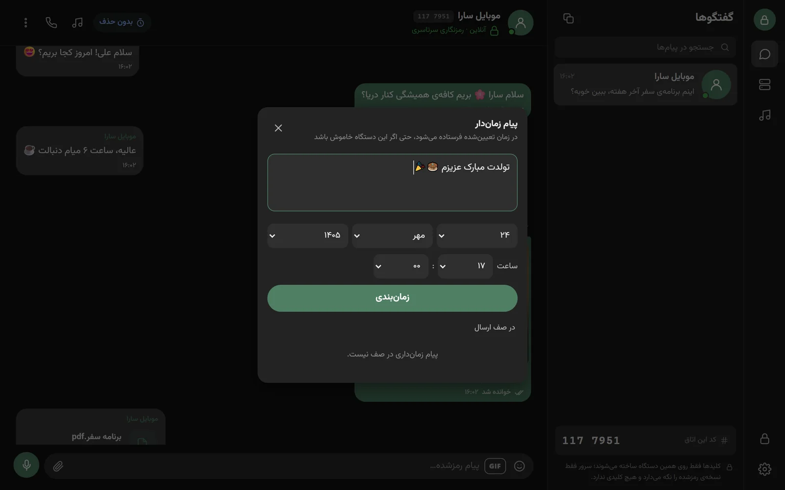

</details>

## نصب روی سرور

`install.sh` همه‌چیز را روی یک سرور **دبیان ۱۲ یا ۱۳** خودکار نصب می‌کند: سایت چت، رله، nginx پشت کلادفلر، گواهی، DNS و (اختیاری) پنل مدیریت. جزئیات کامل‌تر در [README-fa.md](README-fa.md) است.

### پیش‌نیازها

1. یک سرور دبیان ۱۲ یا ۱۳ با دسترسی root.
2. یک دامنه که در کلادفلر اضافه شده و nameserverهایش روی کلادفلر است.
3. یک **API Token** کلادفلر (My Profile ← API Tokens ← Create Custom Token) با این دسترسی‌ها:

| بخش | دسترسی | سطح |
|---|---|---|
| Zone | Zone | Read |
| Zone | DNS | Edit |
| Zone | Zone Settings | Edit |
| Zone | SSL and Certificates | Edit |
| Account | Access: Apps and Policies | Edit |
| Account | Access: Organizations, Identity Providers, and Groups | Edit |
| Account | Calls (Realtime) | Edit (اختیاری، برای تماس) |

### مرحله‌ی ۱: کد را روی سرور بیاورید

این مخزن خصوصی است. یکی از این دو راه:

**با git** (روی سرور، با یک توکن یا deploy key گیت‌هاب):

```bash
git clone https://github.com/wilbernight/najvaa.git /root/najvaa
```

**یا از کامپیوتر خودتان:**

```bash
git archive --format=tar.gz --prefix=najvaa/ -o najvaa.tar.gz HEAD
```

```bash
scp najvaa.tar.gz root@SERVER:/root/
```

و روی سرور:

```bash
cd /root && tar -xzf najvaa.tar.gz
```

### مرحله‌ی ۲: نصب‌کننده را اجرا کنید

```bash
bash /root/najvaa/install.sh
```

نصب‌کننده این‌ها را می‌پرسد:

1. **دامنه‌ی چت**، مثلاً `example.com`.
2. **توکن کلادفلر.** موقع تایپ دیده نمی‌شود.
3. **آدرس‌های سرور:** IPv6 و IPv4 را خودش پیدا می‌کند و می‌پرسد کدام منتشر شود.
4. **تماس صوتی:** ساخت خودکار کلید TURN کلادفلر، یا وارد کردن دستی آن.
5. **فضای تاریخچه:** سقف حجم (پیش‌فرض ۵۰ گیگابایت) و مدت نگه‌داری (پیش‌فرض ۹۰ روز).
6. **پنل مدیریت:** نصب بشود یا نه، آدرس و ایمیل ادمین.

بعد یک خلاصه نشان می‌دهد و با تأیید شما همه‌چیز را انجام می‌دهد:

- نصب nginx و Node.js.
- نصب سایت و رله با محدودیت‌های امنیتی systemd.
- گواهی Origin کلادفلر.
- DNS پروکسی‌شده (IP سرور پنهان می‌ماند).
- SSL سخت‌گیرانه.
- به‌روزرسانی خودکار IP هر ۵ دقیقه.
- (اختیاری) پنل پشت Cloudflare Access.

### مرحله‌ی ۳: ایموجی‌های متحرک (اختیاری)

مجموعه‌ی ایموجی متحرک بزرگ است و داخل git نیست. بدون آن، ایموجی‌ها ساده نمایش داده می‌شوند. برای ساختنش روی کامپیوتر خودتان:

```bash
git clone --depth 1 https://github.com/Tarikul-Islam-Anik/Animated-Fluent-Emojis afe
```

```bash
curl -O https://unicode.org/Public/emoji/15.1/emoji-test.txt
```

```bash
python chat/emoji-src/build_emoji.py afe emoji-test.txt chat/public/emoji
```

و بعد آن را روی سرور کپی کنید:

```bash
rsync -a chat/public/emoji/ root@SERVER:/var/www/DOMAIN/public/emoji/
```

### بعد از نصب

- **چت:** `https://DOMAIN`
- **پنل:** `https://mod.DOMAIN`. اول کد ایمیلی کلادفلر خواسته می‌شود، بعد ورود به پنل، و بعد باید ورود دومرحله‌ای یا passkey را روشن کنید.
- **جای فایل‌های مهم روی سرور:**

| چیز | مسیر |
|---|---|
| تنظیمات و رمزهای رله | `/etc/najva/relay.env` |
| تاریخچه‌ی رمزشده | `/var/lib/najva` |
| لاگ نصب | `/var/log/najva-install.log` |
| سرویس‌ها | `najva-relay`، `najva-ddns.timer`، `najva-panel-scheduler.timer` |

## به‌روزرسانی

- **با نصب‌کننده:** کد جدید را روی سرور بیاورید (`git pull` یا یک بسته‌ی تازه) و دوباره `bash install.sh` را اجرا کنید. جواب‌های قبلی پیش‌فرض می‌شوند. رمزها، گواهی، تاریخچه و دیتابیس پنل دست نمی‌خورند.
- **فقط فایل‌های سایت:** فایل‌ها را در `/var/www/DOMAIN/public` جایگزین کنید.
  - **نسخه:** در هر انتشار، **هر دو** را به یک مقدار برسانید: `chat/public/version.json` و ثابت `APP_VERSION` در `chat/public/app.js`. اگر فقط یکی عوض شود، اپ‌ها پیام «نسخه‌ی تازه آماده است» را نشان می‌دهند ولی به‌روز نمی‌شوند.
  - **ترتیب:** `version.json` را آخر از همه بگذارید. رله تغییر آن را می‌بیند و به همه‌ی اپ‌های باز خبر می‌دهد.
- **تغییر در `chat/server/relay.js`:** فایل را جایگزین کنید و سرویس رله را ری‌استارت کنید:

```bash
systemctl restart najva-relay
```

## ساختار پروژه

| مسیر | چیست |
|---|---|
| `chat/public/` | خود اپ چت: `index.html`، `app.js`، `style.css` و فایل‌های هوش مصنوعی صدا |
| `chat/server/relay.js` | رله‌ی «کور»: پیام‌های رمزشده را بین دستگاه‌ها جابه‌جا و نگه می‌دارد، بدون هیچ کلیدی |
| `chat/emoji-src/` | ساخت مجموعه‌ی ایموجی متحرک |
| `chat/voicefx-src/` | سورس موتورهای تغییر صدا (`node chat/voicefx-src/build-voicefx.mjs`) |
| `chat/ai-src/` | ساخت مدل‌های صدای هوش مصنوعی و تشخیص گفتار فارسی |
| `panel/` | پنل مدیریت (Laravel + Nova) |
| `server-config/` | نمونه‌ی تنظیمات سرور فعلی، بدون رمزها |
| `system/` | به‌روزرسانی خودکار IP در کلادفلر |
| `install.sh` | نصب‌کننده‌ی کامل |
| `docs/screenshots/` | تصویرهای همین صفحه |

</div>
